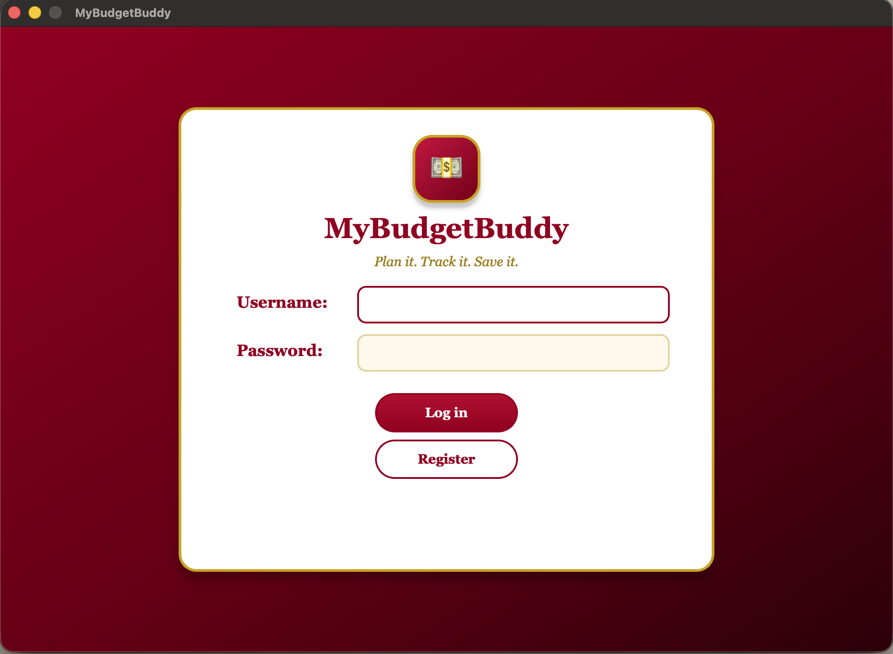
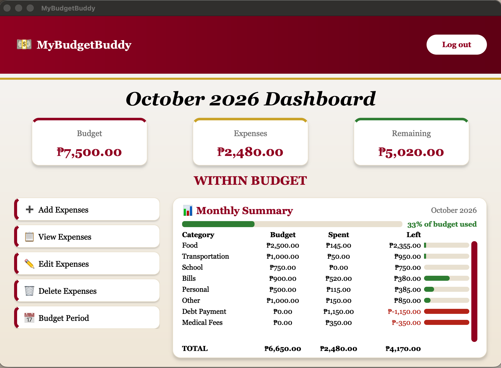
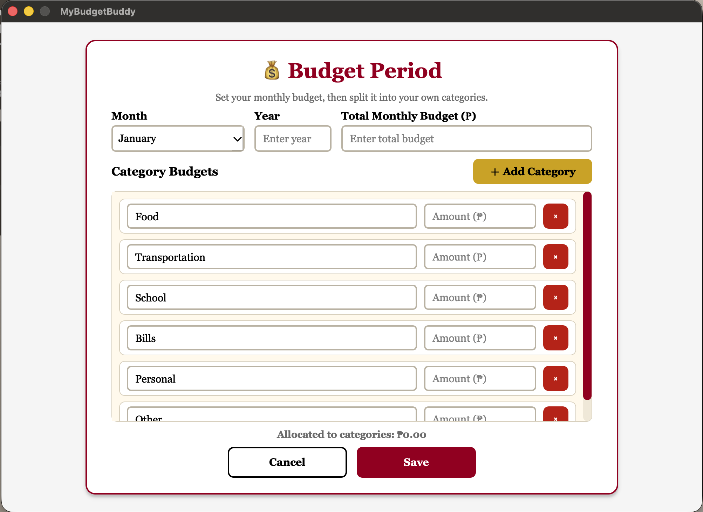
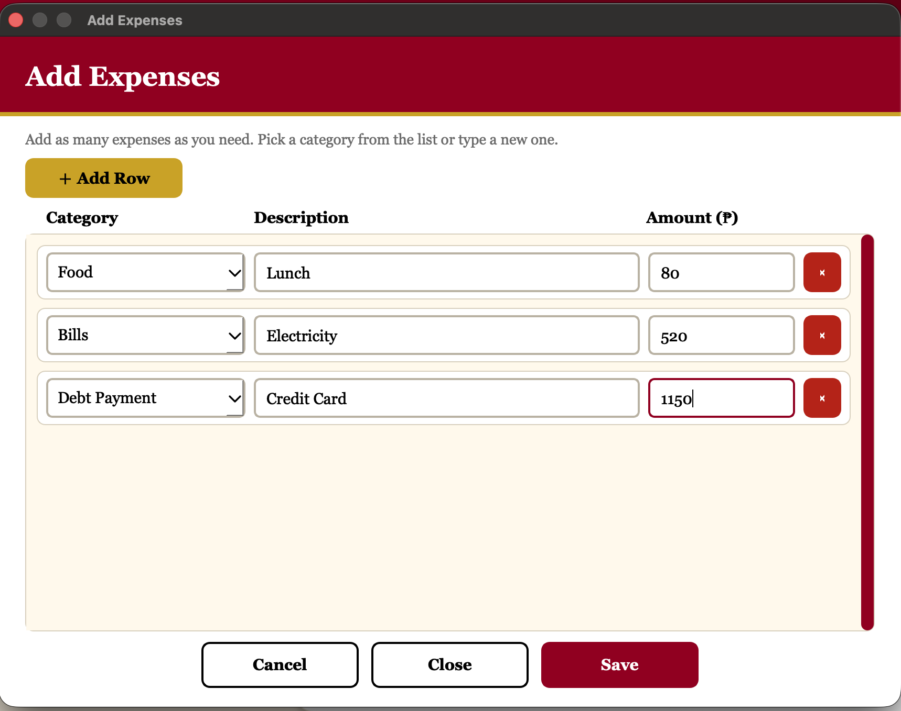
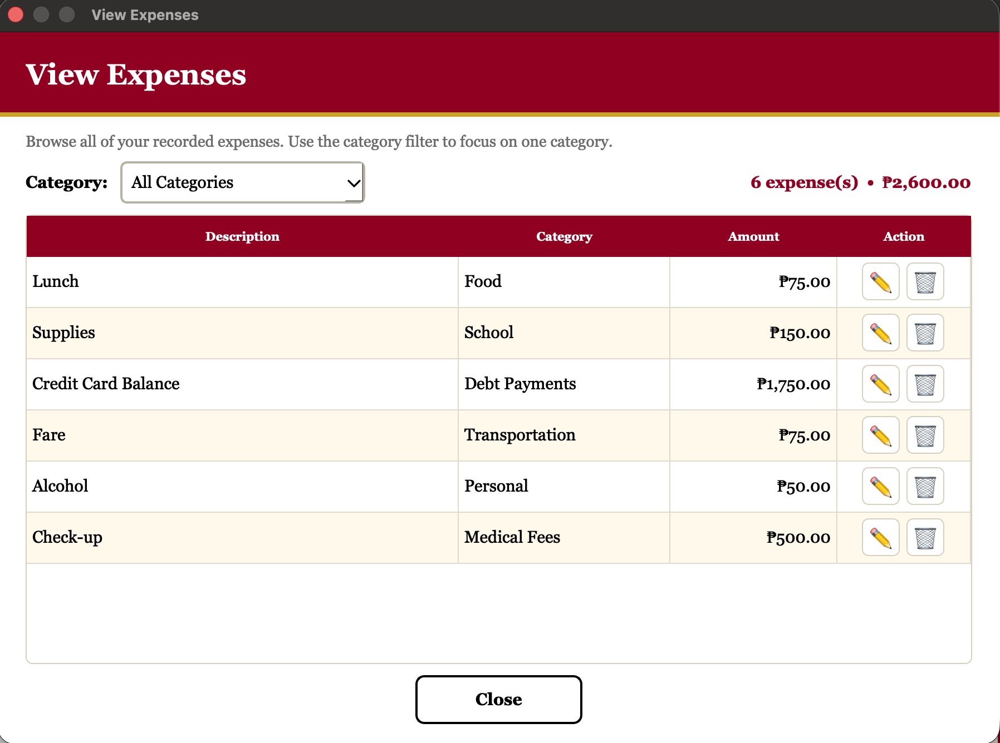
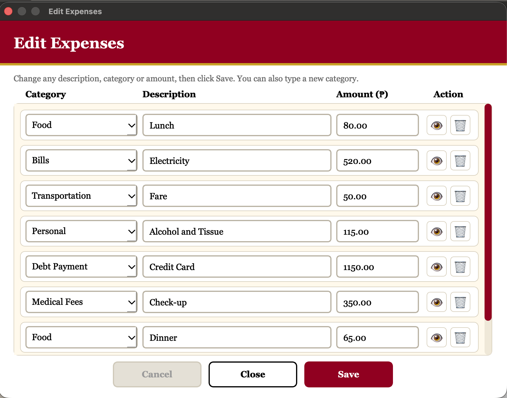
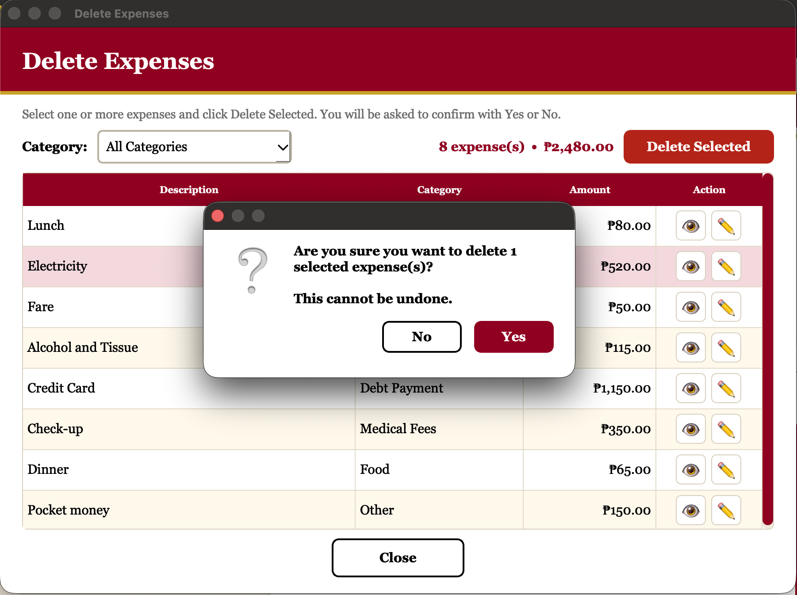

# MyBudgetBuddy

## Project Description

MyBudgetBuddy is a personal budgeting and expense tracking system developed using Python. It allows users to set a monthly budget, create their own spending categories, record expenses, update expenses, delete expenses, and see a live monthly summary right on the dashboard.

The system addresses the problem of manually tracking expenses and budgets. It helps users organize their spending and see how much of their budget has been used and how much remains.

## Project Objectives

The main objectives of MyBudgetBuddy are:

- To create a simple budgeting and expense tracking system.
- To allow users to manage their monthly budget.
- To allow users to record, view, update, and delete expenses.
- To organize expenses into categories that the user can create, add, and remove.
- To show a monthly summary of the user's budget and expenses directly on the dashboard.
- To store user and financial data using a database.
- To apply object-oriented programming and modular programming concepts.

## Features

### User Login

Users can log in using their username and password. Pressing **Enter** also submits the form.

### User Registration

New users can create an account using the Register feature.

### Dashboard

The dashboard is the main screen of the system. It contains:

- The **MyBudgetBuddy** title and the **Log out** button.
- Three cards showing the **Budget**, **Expenses**, and **Remaining** amounts.
- The **budget status** message.
- A **vertical menu on the left** with the buttons *Add Expenses*, *View Expenses*, *Edit Expenses*, *Delete Expenses*, and *Budget Period*.
- The **Monthly Summary on the right**, which is always visible (there is no separate Monthly Summary button anymore).

### Monthly Summary (on the Dashboard)

The summary panel on the right side of the dashboard shows:

- The budget month
- A progress bar showing the percentage of the total budget that has been used
- A scrollable table with the **Budget**, **Spent**, and **Left** amounts of every category, each with its own progress bar
- A **TOTAL** row for all categories

The progress bars change color to show how much has been used: green (safe), orange (80% or more), and red (budget used up or exceeded).

### Budget Period

Users can set their monthly budget and create their own categories:

- Choose the **month** and **year** (the current month and year are selected by default; the saved values are shown when editing).
- Enter the **total monthly budget**.
- **Add Category** adds a new category row with its own budget amount.
- The **✕** button removes a category (categories that already have expenses cannot be removed).
- The category list is **scrollable**, so any number of categories can be added.
- A live label shows how much of the total budget has been allocated and how much is still unallocated (or over).
- **Cancel** returns to the dashboard without saving. **Save** saves the budget.

New accounts start with the suggested categories Food, Transportation, School, Bills, Personal, and Other, but these can be renamed, removed, or replaced.

### Add Expenses

Users can add any number of expenses in one go:

- Each row has a **Category**, **Description**, and **Amount**.
- The category box is a drop-down list of the user's categories, and the user can also **type a new category**. New categories are added to the budget automatically (with a budget of ₱0.00 that can be changed in Budget Period).
- **＋ Add Row** adds more rows, and **✕** removes a row. The page is scrollable.
- Rows that are left completely empty are ignored.
- **Cancel**, **Close**, and **Save** buttons (see *Dialog Buttons* below).

### View Expenses

Users can view their recorded expenses in a scrollable table containing the Description, Category, and Amount.

- A **Category filter** shows all expenses or only one category.
- The number of expenses shown and their total are displayed.
- An **Action** column beside the Amount has two icon buttons: ✏️ (write) opens **Edit Expenses** and 🗑️ (trash) opens **Delete Expenses**, both focused on that expense.
- This page is read-only, so it only has a **Close** button.

### Edit Expenses

Users can update existing expenses in a scrollable page. They can change the description, category (pick or type a new one), and amount of multiple expenses before saving. Includes **Cancel**, **Close**, and **Save** buttons.

An **Action** column beside the Amount has the icon buttons 👁️ (eye), which opens **View Expenses**, and 🗑️ (trash), which opens **Delete Expenses**, both focused on that expense.

### Delete Expenses

Users can select one or more expenses in a scrollable table and click **Delete Selected**. A **Category filter** helps find the right expenses. The deletion is only kept after clicking **Save**. Includes **Cancel**, **Close**, and **Save** buttons.

An **Action** column beside the Amount has the icon buttons 👁️ (eye), which opens **View Expenses**, and ✏️ (write), which opens **Edit Expenses**, both focused on that expense.

### Dialog Buttons

| Button | What it does |
|---|---|
| **Cancel** | Discards the unsaved changes and restores the original values. It stays disabled until something is changed. |
| **Close** | Closes the window. If there are unsaved changes, the user is asked first. The window's X button and the Esc key behave the same way. |
| **Save** | Checks the entries, saves them, and closes the window. |

### Action Icons (Shortcuts)

The View, Edit, and Delete Expenses pages each have an **Action** column beside the Amount. The icons work as shortcuts to the other pages, so they do the same thing as the matching buttons on the dashboard:

| Icon | Opens | Shown in the Action column of |
|---|---|---|
| 👁️ Eye | View Expenses | Edit Expenses, Delete Expenses |
| ✏️ Write | Edit Expenses | View Expenses, Delete Expenses |
| 🗑️ Trash | Delete Expenses | View Expenses, Edit Expenses |

The page that opens is focused on the expense whose icon was clicked (the row is selected or scrolled into view). If the current page has unsaved changes, the user is asked before leaving it.

### Budget Status

The system checks the user's spending and displays the current budget status:

- WITHIN BUDGET
- WARNING: 80% OF BUDGET USED
- BUDGET FULLY USED
- OVER BUDGET

### Design Theme

The program uses a budgeting theme: burgundy and gold on a warm cream background, coin and chart icons, rounded cards, and progress bars that turn green, orange, or red depending on how much of a budget has been spent. All text in the program uses the **Georgia** font. The colors and styles are defined at the top of each `view.py` file, so the look of every screen can be changed in the file where that screen is written.

## Technologies Used

### Programming Language

- Python

### GUI Framework

- PyQt6

### Database

- SQLite

### Libraries and Tools

- `sqlite3` - used for SQLite database operations.
- PyQt6 - used to create the graphical user interface.
- PyCharm - used for developing and testing the project.
- GitHub - used for version control and project storage.

## Project Structure

```text
MyBudgetBuddy/
│
├── main.py
├── mybudgetbuddy.db
│
├── database/
│   ├── __init__.py
│   └── database.py
│
├── features/
│   ├── __init__.py
│   │
│   ├── authentication/
│   │   ├── __init__.py
│   │   ├── model.py
│   │   ├── repository.py
│   │   ├── service.py
│   │   └── view.py
│   │
│   ├── budget/
│   │   ├── __init__.py
│   │   ├── model.py
│   │   ├── service.py
│   │   └── view.py
│   │
│   ├── expenses/
│   │   ├── __init__.py
│   │   ├── model.py
│   │   ├── repository.py
│   │   ├── service.py
│   │   └── view.py
│   │
│   └── dashboard/
│       ├── __init__.py
│       └── view.py
│
├── screenshots/
│   ├── login.png
│   ├── dashboard.png
│   ├── budget-period.png
│   ├── add-expenses.png
│   ├── view-expenses.png
│   ├── edit-expenses.png
│   └── delete-expenses.png
│
└── README.md
```

### File and Folder Description

**`main.py`**

The main entry point of the application. It starts the PyQt6 application, sets Georgia as the font of the whole program, creates the database tables, and opens the login screen.

**``**

Contains the files responsible for connecting to and managing the SQLite database.

**`database/database.py`**

Creates the database tables (and the default `admin` account), and performs the main database saving and loading operations. Category budgets are loaded in the order the user entered them.

**`features`**

Contains the different features of the system.

**`features/authentication`**

Contains the login and registration functionality.

- `model.py` - creates user data.
- `repository.py` - handles user data storage and registration.
- `service.py` - handles login and account creation logic.
- `view.py` - displays the login and registration interface. Contains the colors and styles used by this screen.

**`features/budget`**

Contains the budget functionality.

- `model.py` - creates budget data.
- `service.py` - calculates remaining budget, budget status, usage percentage, handles the dynamic category list, and provides the helpers `parse_amount` (checks and converts amount text), `clean_name` (trims category names), and `match_name` (finds a category ignoring uppercase/lowercase). The expenses feature also uses these helpers.
- `view.py` - displays the Budget Period interface with add/remove category rows, Cancel, and Save. Contains the colors and styles used by this screen.

**`features/expenses`**

Contains the expense functionality.

- `model.py` - creates expense data.
- `repository.py` - handles adding, updating, and deleting expenses.
- `service.py` - handles expense operations, category filtering, multi-delete, and calculations.
- `view.py` - displays the Add, View, Edit, and Delete Expense interfaces, including the Action icon buttons. Contains the colors and styles used by these screens.

**`features/dashboard`**

Contains the main dashboard interface.

- `view.py` - displays the dashboard (menu on the left, Monthly Summary on the right) and connects the different features of the system. Contains the colors and styles used by the dashboard.

**`screenshots`**

Contains screenshots of the working application.

## Installation and Setup

### 1. Install Python

Make sure Python is installed on the computer.

### 2. Download or Clone the Project

Download the MyBudgetBuddy project or clone the project from GitHub.

### 3. Open the Project

Open the project folder using PyCharm.

### 4. Install the Required Dependency

Open the terminal in the project folder and run:

```bash
pip install PyQt6
```

The project only requires PyQt6 because SQLite is already included with Python through the `sqlite3` module.

### 5. Run the Application

Run the following file:

```text
main.py
```

The MyBudgetBuddy login screen will appear.

## How to Use the System

### 1. Login

Start the application and log in using an existing account.

A default account is available:

```text
Username: admin
Password: admin123
```

Users can also click **Register** to create a new account.

### 2. Set the Budget

After logging in for the first time, the **Budget Period** page opens automatically. It can also be opened later from the menu on the left of the dashboard.

Select the month, enter the year and the total monthly budget, then fill in the amount for each category. Click **＋ Add Category** to create more categories, or **✕** to remove one.

Click **Save** to save the budget, or **Cancel** to go back without saving.

### 3. Add Expenses

Click **Add Expenses**.

For each expense, choose a category (or type a new one), then enter the description and amount. Click **＋ Add Row** for more expenses.

Click **Save** to save the expenses. **Cancel** restores the form, and **Close** closes the window.

### 4. View Expenses

Click **View Expenses** to see the recorded expenses. Use the **Category** filter to show only one category and scroll if the list is long. Click ✏️ or 🗑️ in the **Action** column to jump straight to editing or deleting that expense.

### 5. Edit Expenses

Click **Edit Expenses**.

The existing expenses will be displayed with editable fields. Users can change multiple expenses and then click **Save**. Use 👁️ or 🗑️ in the **Action** column to jump to viewing or deleting that expense.

### 6. Delete Expenses

Click **Delete Expenses**.

Select one or more expenses and click **Delete Selected**, then click **Save** to confirm the changes. Use 👁️ or ✏️ in the **Action** column to jump to viewing or editing that expense.

### 7. Read the Monthly Summary

The Monthly Summary is always shown on the right side of the dashboard. It shows the budget, spending, and what is left for every category, plus the overall percentage of the budget used.

### 8. Logout

Click **Log out** to return to the login screen.

## OOP Implementation

MyBudgetBuddy uses object-oriented programming through PyQt6 classes and custom classes.

### Important Classes

**`App`**

The `App` class in `features/dashboard/view.py` inherits from `QMainWindow`.

It controls the main application window and connects the different features such as the dashboard, budget, expenses, and logout.

**`FormDialog`**

The `FormDialog` class in `features/expenses/view.py` inherits from `QDialog`.

It is the base dialog for all expense windows. It builds the title banner, the scrollable body, and the **Cancel**, **Close**, and **Save** buttons.

**`ExpenseFormDialog`**

Inherits from `FormDialog`. It is used for adding expenses.

**`ExpenseEditDialog`**

Inherits from `FormDialog`. It is used for editing expenses.

**`ExpenseListDialog`**

Inherits from `FormDialog`. It is used for viewing and deleting expenses (`mode="view"` or `mode="delete"`).

**`action_buttons`**

A helper in `features/expenses/view.py` that creates the 👁️ / ✏️ / 🗑️ icon buttons of the Action column. The dialogs use `go_to()` from `FormDialog` to close themselves and let the dashboard open the requested page.

**`ExpenseRow`** and **`CategoryRow`**

Inherit from `QFrame`. Each one represents a single editable row (an expense or a category) and is created as many times as needed, which makes the categories dynamic.

### Encapsulation

Encapsulation is applied by organizing related data and functions inside classes and modules.

For example, `ExpenseRow` keeps its input fields inside the class and exposes only `values()` and `set_values()`.

The project also separates the model, repository, service, and view responsibilities into different files.

### Inheritance

Inheritance is used in the PyQt6 interface and in the dialogs.

For example:

```python
class App(QMainWindow):
```

```python
class FormDialog(QDialog):
```

and:

```python
class ExpenseFormDialog(FormDialog):
class ExpenseEditDialog(FormDialog):
class ExpenseListDialog(FormDialog):
```

The three expense dialogs inherit the banner, the footer buttons, and the unsaved-changes behavior from `FormDialog`.

### Polymorphism

Polymorphism is applied when each dialog overrides the same methods of `FormDialog` with its own behavior:

- `has_changes()` - checks if there is unsaved work.
- `reset()` - restores the original values (used by **Cancel**).
- `on_save()` - validates and saves (used by **Save**).

The base class calls these methods without needing to know which dialog it is, so the same **Cancel**, **Close**, and **Save** buttons behave correctly in every window.

## Database

MyBudgetBuddy uses SQLite for data storage.

The database file is:

```text
mybudgetbuddy.db
```

The database is created and managed using Python's built-in `sqlite3` module.

### Database Tables

The system contains the following tables. Every record belongs to one user, so each account has its own data.

### `users`

Stores user account information.

Important fields:

- `id`
- `username`
- `password`

### `user_budgets`

Stores the monthly budget of each user.

Important fields:

- `user_id`
- `month`
- `total`

### `user_category_budgets`

Stores the budget assigned to each category. The categories are created by the user, so there is no fixed list.

Important fields:

- `user_id`
- `category`
- `amount`

### `user_expenses`

Stores recorded expenses.

Important fields:

- `id`
- `user_id`
- `description`
- `category`
- `amount`

### Database Operations

The system performs the following database operations.

**Create**

Creates database tables and inserts new users, budgets, category budgets, and expenses.

**Read**

Reads the user's budget, category budgets, and expenses from the database when the user logs in.

**Update**

Updates saved information when the user changes the budget or edits expenses.

**Delete**

Removes expense records when the user deletes an expense and saves the changes.

**Search**

The login system searches the users table to check whether the entered username and password match an existing account.

## Screenshots

> Retake these screenshots after running the updated program.

### Login Screen



Shows the login interface where users can enter their username and password.

### Dashboard



Shows the main dashboard with the monthly budget, total expenses, remaining budget, budget status, the menu on the left, and the Monthly Summary on the right.

### Budget Period



Shows the Budget Period interface where users can select a month, enter the monthly budget, and add or remove their own categories.

### Add Expenses



Shows the interface for entering expenses with a category, description, and amount on each row.

### View Expenses



Shows the scrollable table containing the user's recorded expenses, the category filter, and the Action column with the edit and delete icons.

### Edit Expenses



Shows the scrollable form for changing existing expenses, with the view and delete icons in the Action column.

### Delete Expenses



Shows the table where expenses are selected for deletion, with the view and edit icons in the Action column.

## Testing

The system was tested by performing different actions in the application and checking whether the expected results matched the actual results.

| Test | Expected Result | Actual Result |
|---|---|---|
| Login with correct account | User enters the system | Passed |
| Login with incorrect password | Login should be rejected | Passed |
| Register a new account | New account should be created | Passed |
| Set monthly budget | Budget should be saved | Passed |
| Add an expense | Expense should appear in View Expenses | Passed |
| View expenses | Saved expenses should be displayed | Passed |
| Edit an expense | Updated information should appear | Passed |
| Edit multiple expenses | Multiple changes should be saved | Passed |
| Delete an expense | Selected expense should be removed | Passed |
| Logout | User should return to login screen | Passed |
| Monthly Summary on dashboard | Category budgets, spent, and left amounts are shown on the right side | _To be tested_ |
| Add a new category in Budget Period | New category appears in the budget and in the summary | _To be tested_ |
| Remove a category without expenses | Category is removed after Save | _To be tested_ |
| Type a new category in Add Expenses | Expense is saved and the category appears in the summary | _To be tested_ |
| Add many rows in Add Expenses | Page scrolls and all rows are saved | _To be tested_ |
| Filter View Expenses by category | Only the chosen category is displayed | _To be tested_ |
| Delete several expenses | Selected expenses are removed after Save | _To be tested_ |
| Action icons in View Expenses | ✏️ opens Edit Expenses and 🗑️ opens Delete Expenses on the chosen expense | _To be tested_ |
| Action icons in Edit Expenses | 👁️ opens View Expenses and 🗑️ opens Delete Expenses on the chosen expense | _To be tested_ |
| Action icons in Delete Expenses | 👁️ opens View Expenses and ✏️ opens Edit Expenses on the chosen expense | _To be tested_ |
| Click an Action icon with unsaved changes | A confirmation message appears before leaving the page | _To be tested_ |
| Georgia font | All text in the program uses Georgia | _To be tested_ |
| Cancel button | Unsaved changes are discarded | _To be tested_ |
| Close with unsaved changes | A confirmation message appears | _To be tested_ |

## Known Issues / Limitations

- The system is designed as a simple college-level budgeting application.
- User passwords are stored as plain text and are not encrypted.
- The application currently supports one budget period at a time.
- Category names of existing budget categories cannot be renamed (remove and re-add a category that has no expenses instead).
- The system does not have online or cloud database synchronization.
- The application does not support multiple users using the application at the same time.
- The system does not include advanced financial reports or charts.
- The application is intended for basic personal budgeting and expense tracking.

## Author

**Name:** Mechelle Laguitao

**Section:** CS26(3581) BSCS-2
